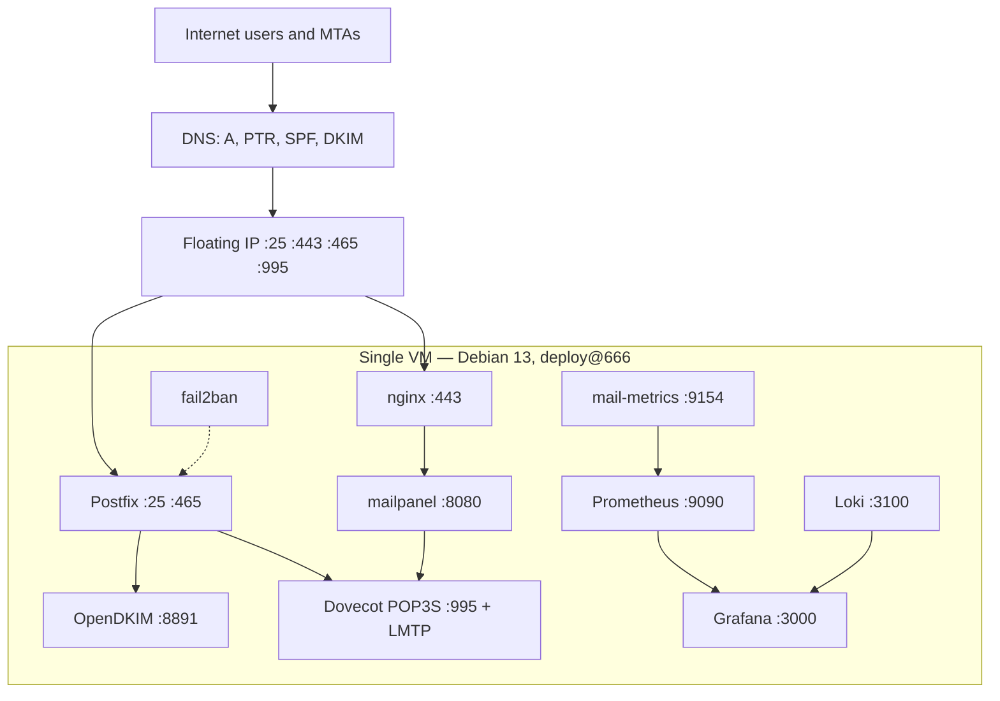

# single-vm-mail-platform

**A complete mail platform on one VM.** Postfix + Dovecot + OpenDKIM + a mailbox
panel + local observability, provisioned with Terraform and configured with Ansible.


Sized and hardened for **500+ mailboxes** and **25 000 messages/day** on a single
4 vCPU / 8 GB VM. Virtual users, POP3S delivery, and a stack you can read end to end.

---

## Design



Three decisions shape everything else:

1. **One VM, host packages.** The mail queue is a `postqueue -p` away, and every
   component is a package you can inspect, patch and reason about.
2. **POP3S delivery.** Mail is downloaded and removed by the client; retention
   expunges only `\Seen` mail. The disk stays flat at 500+ mailboxes, and the model
   matches how small offices actually work.
3. **SQLite is the source of truth.** The panel writes accounts, a sync script
   renders Postfix and Dovecot maps atomically. One file to back up, one file to
   restore.

---

## What's inside

| Layer | What you get |
| --- | --- |
| **Terraform** | Network, subnet, router, security group, port, floating IP, boot volume, VM, cloud-init. Local state by default, optional S3 backend |
| **Ansible** | 6 roles: `base`, `fail2ban`, `mail`, `dkim`, `monitoring`, `panel` |
| **Mail** | Postfix (25 inbound, 465 SMTPS+SASL), Dovecot 2.4 (POP3S 995 + LMTP), OpenDKIM, RBL + cidr blacklist, 50 MB message cap |
| **Accounts** | SQLite + `doveadm` hashing, atomic map sync, CSV import-if-empty, `IMPORT_MISSING` for incremental |
| **Panel** | stdlib HTTP server, HMAC sessions, rate limiting, mailbox CRUD, password reset, redirects, autoreplies with date windows |
| **Retention** | Daily `doveadm expunge` of downloaded mail older than 30 days |
| **Observability** | Prometheus, Grafana, Loki, Promtail, `mail-metrics` exporter, 3 provisioned dashboards — all loopback |
| **Hardening** | ufw, 5 fail2ban jails, SSH on a non-default port, key-only auth, CSP + HSTS |
| **Tooling** | `ops` CLI: `check-maps`, `users-import`, `users-sync`, `dkim-check`, `smoke`, `doctor`, `inventory` |
| **Tests** | 114 unit tests (Jinja contracts, panel HTTP, maps, secrets) + 4 service tests (ansible, terraform, shellcheck) |

---

## Quickstart

```bash
# 1. Deploy key
ssh-keygen -t ed25519 -C "deploy@mail" -f ~/.ssh/mail_deploy
cp ~/.ssh/mail_deploy.pub keys/deploy.pub

# 2. Cloud credentials
cp terraform/examples/selectel.tfvars.example terraform/terraform.tfvars
$EDITOR terraform/terraform.tfvars

# 3. Provision
make tf-init
terraform -chdir=terraform apply

# 4. Inventory + host configuration
make inventory
export MAIL_ADMIN_USER=admin MAIL_ADMIN_PASSWORD='...' MAIL_SESSION_SECRET="$(openssl rand -hex 32)"
make deploy

# 5. Verify
make smoke HOST=$(terraform -chdir=terraform output -raw public_ip_address)
```

Full walkthrough: [`docs/getting-started.md`](docs/getting-started.md).

---

## Make targets

| Target | Action |
| --- | --- |
| `make help` | list every target |
| `make fmt` / `make validate` | `terraform fmt -check` / `terraform validate` |
| `make test-quick` | unit tests |
| `make test-service` | ansible, terraform and shellcheck contracts |
| `make test-full` | both |
| `make verify-ansible` | ansible syntax + handler notify contracts |
| `make tf-init` / `make tf-plan` | terraform init / plan |
| `make bootstrap` | lab path: key → tfvars → apply → inventory → playbook |
| `make inventory` | write `ansible/inventory.ini` from terraform output |
| `make deploy` | `ansible-playbook` (code only, keeps server env) |
| `make smoke HOST=<ip>` | ports + TLS after deploy |
| `make doctor` | diagnostic bundle |
| `make check-maps` | diff rendered maps against deployed files |
| `make ci-setup` / `make ci-key-install` | one-time CI deploy key |

---

## Docs

| Document | Contents |
| --- | --- |
| [`docs/architecture.md`](docs/architecture.md) | layers, versions, ports, constraints |
| [`docs/getting-started.md`](docs/getting-started.md) | zero to first mailbox |
| [`docs/mail.md`](docs/mail.md) | Postfix, Dovecot, maps, retention, DKIM, DNS |
| [`docs/openstack.md`](docs/openstack.md) | Selectel and generic OpenStack specifics |

---

## Repository layout

```
single-vm-mail-platform/
├── terraform/          network, compute, cloud-init, examples/
├── ansible/            playbook + 6 roles + group_vars
├── panel/              mailbox UI (stdlib HTTP, SQLite)
├── scripts/            ops CLI (Python) + shell automation
├── tests/              unit + service
├── docs/               architecture, getting started, mail, openstack
├── keys/               deploy.pub placeholder
└── dkim/               published DKIM record placeholder
```

---

## Requirements

| Component | Version |
| --- | --- |
| Terraform | `>= 1.10` |
| Ansible | `>= 2.15` (`ansible.posix`, `community.general`) |
| Python | `>= 3.11` |
| Cloud | OpenStack or Selectel, floating IP pool |
| DNS | A, PTR, SPF, DKIM, MX for your domain |
| TLS | wildcard certificate for your domain |

---

## Security

- SSH on a non-default port, key-only, root login disabled, `ssh.socket` masked.
- ufw allows exactly `ssh_port`, 25, 443, 465, 995.
- fail2ban jails: `sshd`, `postfix`, `postfix-sasl`, `dovecot`, `mailpanel-auth`.
- Panel: HMAC session cookies, 5 failed logins / 300 s per IP, CSP + HSTS on every
  response, public static allowlist limited to login assets.
- Grafana shares the panel session — nginx `auth_request` against the panel.
- Relay is restricted to authenticated senders and `mynetworks`.
- Secrets stay out of git: `terraform.tfvars`, `s3-backend.env`, `ssl/`,
  `dkim/*.private`, `data/*.csv`, `ansible/inventory.ini`, `.panel-creds`.
  `gitleaks` runs in CI.

---

## Status

Production-proven architecture, packaged as a reusable template. The Terraform and
Ansible layers ran a live mail platform at 500+ mailboxes; the public tree keeps the
behaviour and ships with `example.com` and RFC 5737 placeholders throughout.

CI verifies secret scanning, unit tests, service tests, and Terraform formatting and
validation on every push.

---

## License

[PolyForm Shield 1.0.0](LICENSE) — source-available, no competing product.
Required Notice: Copyright 2026 Eugene Grossbart / piniq.ai (https://piniq.ai)
