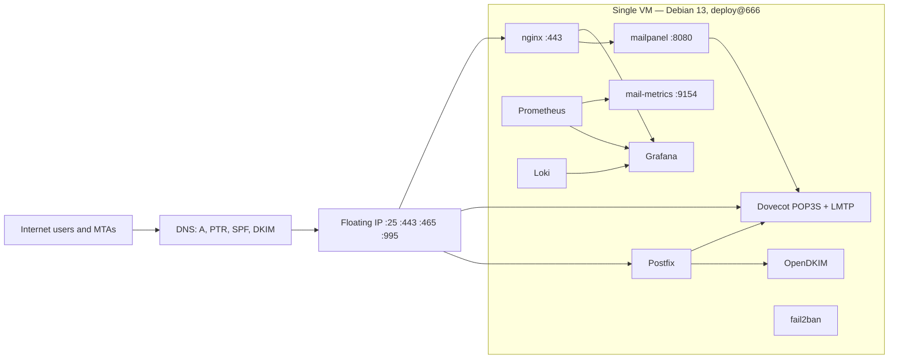

# Architecture

Dense map of the repository. Human showcase: [`README.md`](../README.md).

## Purpose

Single-VM mail host: Terraform provisions network, VM and floating IP; Ansible
configures the host and deploys Postfix + Dovecot 2.4 + OpenDKIM + an nginx-fronted
mailbox panel + local observability. Virtual users only — no system accounts.

Sized for **500+ mailboxes** and **25 000 messages/day** on one 4 vCPU / 8 GB VM.

**Not in scope:** IMAP, Docker, Traefik, ACME/HTTP-01 (`:80` closed), multi-node,
`terraform apply` in CI, shipping logs to a remote Loki.

## Stack versions

| Component | Version | Source |
| --- | --- | --- |
| Terraform | `>= 1.10` | `terraform/versions.tf` |
| Provider `selectel/selectel` | `~> 7.1` | `terraform/versions.tf` |
| Provider `openstack/openstack` | `2.1.0` | `terraform/versions.tf` |
| VM OS | Debian 13 (Trixie) 64-bit | `terraform/variables.tf` |
| Dovecot | **2.4** syntax (`dovecot_config_version = 2.4.0`) | `ansible/roles/mail/templates/dovecot.conf.j2` |
| Postfix / OpenDKIM / nginx / fail2ban | distro packages | `ansible/roles/*` |
| Grafana | 13.2.0 OSS deb (pinned download) | `ansible/roles/monitoring/defaults/main.yml` |
| Loki / Promtail | 3.5.1 | same |
| Python (tooling) | `>= 3.11` | `pyproject.toml` |

## Layer diagram

SSH is on `ssh_port` (default 666). Prometheus, Grafana, Loki and mail-metrics bind
loopback; Grafana is reached only as `https://mail.example.com/grafana/` behind the
panel `auth_request`.

## Identity

| Role | Mechanism |
| --- | --- |
| Source | Ansible inventory group `[mail]`; `hostname: "{{ group_names[0] }}"` in `group_vars/all.yml` |
| Server paths | `/opt/mail/panel`, `/var/lib/mailpanel/users.db`, `/var/vmail/example.com/<local>/Maildir` |
| Terraform | `var.hostname` — OpenStack name prefix, not the OS `HOSTNAME` |
| Mail FQDN | `mail_fqdn` / `mail_domain` in `group_vars/all.yml` |

The inventory group name and `var.hostname` must match.

## Terraform

| Area | Behavior |
| --- | --- |
| Backend | Local state by default; optional S3 via `backend.s3.hcl.example` |
| Network | VPC, subnet, router, SG public TCP `ssh_port/25/443/465/995`, port, floating IP |
| Compute | Boot volume (Debian 13, 100 GB default, IOPS cap), VM flavor, `user_data` = cloud-init |
| SSH key | `keys/deploy.pub` → OpenStack keypair + cloud-init `deploy` authorized_keys |
| Cloud-init | `deploy` user, `ssh_port`, mask `ssh.socket`, no root/password SSH |
| Guards | `prevent_destroy` on router, floating IP, boot volume; `disk_size_gb >= 100` |

No `:80` in the security group — bring your own wildcard certificate, no ACME.

**Immutable on replace:** router, router interface, network/subnet, port, floating IP.
Boot volume grows fine; shrink or replace is data loss (Maildir lives there).

## Ansible

`playbook.yml` — roles in order: `base` → `fail2ban` → `mail` → `dkim` → `monitoring` → `panel`.

| Role | Function |
| --- | --- |
| `base` | apt packages, timezone, unattended-upgrades, journald cap, ufw ports |
| `fail2ban` | jails `sshd`, `postfix`, `postfix-sasl`, `dovecot`, `mailpanel-auth`; bans via ufw |
| `mail` | Postfix + Dovecot, TLS PEMs, virtual maps, retention timer |
| `dkim` | OpenDKIM milter on `127.0.0.1:8891` |
| `monitoring` | Prometheus + Grafana + Loki + Promtail + mail-metrics (loopback only) |
| `panel` | nginx :443, mailpanel systemd, CSV import-if-empty, sudoers for map sync |

## Mail stack

### Postfix

| Item | Value |
| --- | --- |
| Inbound | `smtp` :25 — RBL + cidr blacklist after auth checks |
| Submission | `smtps` :465, `smtpd_tls_wrappermode=yes`, SASL required |
| Delivery | `virtual_transport = lmtp:unix:private/dovecot-lmtp` |
| Maps | `hash:/etc/postfix/vmailbox`, `hash:/etc/postfix/virtual`, `hash:/etc/postfix/virtual_redirect` |
| TLS | `>=TLSv1.2`, `/etc/ssl/mail/fullchain.pem` |
| Size | `message_size_limit = 52428800` (50 MB) |
| Milter | OpenDKIM `inet:127.0.0.1:8891`; `milter_default_action = accept` |

No open relay: `smtpd_relay_restrictions = permit_mynetworks permit_sasl_authenticated reject_unauth_destination`.

### Dovecot

| Item | Value |
| --- | --- |
| Protocols | `pop3` + `lmtp` only (no IMAP package, no :143/:993) |
| POP3S | :995 `ssl = yes`; plain :110 `port = 0` |
| Auth | `PLAIN`/`LOGIN`, `auth_allow_cleartext = no`, `ssl = required` |
| Login forms | bare `user` or `user@example.com` |
| passdb/userdb | `/etc/dovecot/users`, scheme `SSHA512` |
| Home | `/var/vmail/example.com/%{user \| username}`, uid/gid `vmail` (5000) |
| Seen | `pop3_no_flag_updates = no` — RETR marks `\Seen` so retention can expunge |

### Accounts

Source of truth: SQLite `/var/lib/mailpanel/users.db` (hashes only). The sync script
atomically rewrites `/etc/dovecot/users` + Postfix maps and runs `postmap`.

| Path | When |
| --- | --- |
| CSV import | First deploy only, when the DB is empty (`INSERT OR IGNORE`) |
| Panel CRUD | `add_user` / `set_password` / `delete_user` → `doveadm pw -s SSHA512` → sync |
| `IMPORT_MISSING=1` | Insert locals present in CSV but missing in SQLite |

CSV columns: `username,email,full_name,password,archived`.

### Retention

`mail-cleanup.timer` daily: `doveadm expunge -A mailbox INBOX SEEN savedbefore 30d`.
Unseen (not yet downloaded) mail is never touched.

### OpenDKIM

Selector `mail` (override `DKIM_SELECTOR`). Signs when Postfix sets `{auth_type}`
(authenticated 465). Socket `inet:8891@127.0.0.1`. Private key from the controller
`dkim/mail.private` → `/etc/opendkim/keys/example.com/mail.private`.

### Optional external milter

Any content filter can be prepended to `smtpd_milters` in
`ansible/roles/mail/templates/main.cf.j2`; set `ess_milter_host` in `group_vars/all.yml`
and open the port in `terraform/network.tf`. Empty by default.

### Antispam (port 25)

`permit_mynetworks` → `permit_sasl_authenticated` → `reject_unauth_destination` →
`check_client_access cidr:/etc/postfix/client_blacklist` → `reject_rbl_client` for
`zen.spamhaus.org` and `bl.spamcop.net`.

## Ops panel

stdlib `ThreadingHTTPServer` as user `mailpanel`, bind `127.0.0.1:8080`. nginx
terminates TLS and reverse-proxies `/` to the panel.

Grafana is not a second login: `location /grafana/` uses nginx `auth_request /auth/verify`;
the panel sets `X-User`, nginx forwards `X-WEBAUTH-USER`.

| Item | Mechanism |
| --- | --- |
| Credentials | `MAIL_ADMIN_USER` / `MAIL_ADMIN_PASSWORD` / `MAIL_SESSION_SECRET` in `/etc/mailpanel.env` |
| Session | HMAC cookie; rotating the secret invalidates all sessions |
| Rate limit | 5 failures / 300 s per IP, then 429 and fail2ban |
| Domain | `MAIL_DOMAIN`; injected into the page as `<meta name="mail-domain">` |

| Method | Path | Auth |
| --- | --- | --- |
| GET | `/health` | session or loopback |
| GET | `/auth/verify` | session cookie (nginx internal) |
| GET/POST | `/login` `/logout` | public |
| GET | `/` | session |
| GET | `/api/health` | session |
| GET | `/api/users` | session |
| POST | `/api/users` | session |
| POST | `/api/users/<local>/password` | session |
| POST | `/api/users/<local>/delete` | session |
| GET/POST | `/api/users/<local>/redirects` | session |
| GET/POST | `/api/users/<local>/autoreply` | session |

CSP + HSTS on every response. Public static allowlist for login assets only.

## Observability

All scrapers and UIs bind `127.0.0.1`. ufw has no 9100/9090/3100/9154 holes.

| Piece | Bind | Notes |
| --- | --- | --- |
| Prometheus | `:9090` | scrapes `node` `:9100` and `mail` `:9154` every 15 s |
| Grafana | `:3000` | `root_url=/grafana/`, proxy auth, home dashboard `mail.json` |
| Loki | `:3100` | filesystem TSDB under `/var/lib/loki` |
| Promtail | `:9080` | jobs `mail` (`/var/log/mail.log`) and `systemd` journal |
| mail-metrics | `:9154` | tails `mail.log` + `postqueue`; counters for connects/sent/deferred/rejected/RBL/POP3/LMTP/DKIM + queue gauge |

Provisioned dashboards: `server.json`, `mail.json`, `mail-logs.json`.

## Constraints

- No `terraform apply` in CI.
- SSH on `ssh_port` only; do not unmask `ssh.socket`.
- No IMAP, no plain POP3 :110, no HTTP :80, no Docker, no Traefik.
- Do not delete `/etc/dovecot/users` or `users.db` on a live host to "refresh" from CSV —
  import is empty-DB only; use the panel to change passwords.
- Mailbox files live on the boot volume; shrink or replace is data loss.
- Workflow jobs call `make` targets (no inline ansible/terraform in YAML).
- Grafana/Prometheus/Loki stay on loopback; do not publish :3000/:9090/:3100/:9154.
- Authenticated SMTPS :465 must stay ahead of RBL in restriction lists.
